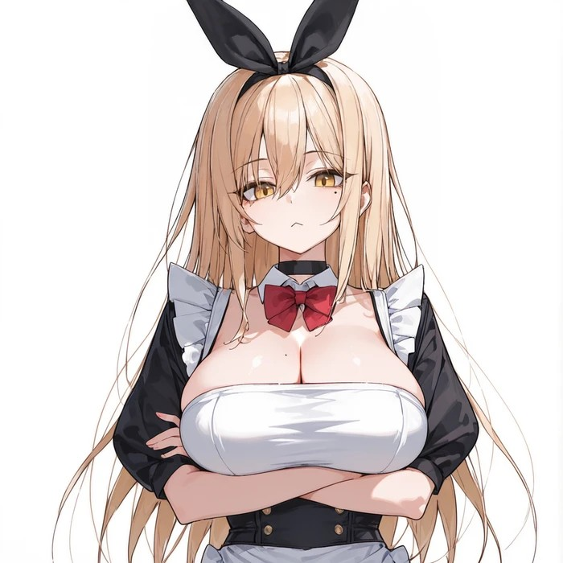

안녕

오랜만이야

프로그램이 업데이트 되었어

삽화가 주 내용이고, 그 외에는 보안이라던가 코드 최적화 관련된 부분들임

최근 며칠동안 삽화 시스템을 크게 손봤고,

오케스트레이션은 사실상 아예 구조부터 바꿨어

이번 리뉴얼 작업을 하면서 내가 가장 중점을 둔 부분은 안정성이야

누구나 쓸 수 있게 가장 기본 흐름이 되는 오케스트레이션은 단순화하고,

나머지 품질을 높이는 에이전트를 옵션으로 두었어

또한 에이전트간 교환 형식을 단순화하여, 적어도, 왠만하면 한번에 성공할 수 있게 두었어

그리고 삽화에서 LLM 추론과 이미지 생성을 동시에 진행해

생성 시간의 상당 부분을 LLM 추론 뒤에 숨길 수 있기 때문에, 전체적인 삽화 생성 시간이 크게 단축되었어

일부 UI 레벨을 조절해서 일부 메뉴에 바로바로 접근할 수 있도록 조정했어

이번 안정성 개선 + 추론 시간 최적화로 삽화 추론 시간이 크게 단축되었을꺼야, 이 프로그램을 삽화용도로 쓰고 있었다면 꼭 업데이트 하는 걸 추천할께

관련하여 내용과 UI 구성이 바뀌었고 원본 글의 가이드와 현재 프로그램이 맞지 않는 부분이 있어서, 리뉴얼 가이드를 새로 작성했어

프로그램 업데이트를 진행한 다음 아래 가이드를 따라가주자

https://arca.live/b/characterai/186408177

이번 업데이트 대부분의 내용이 가이드에 있기 때문에 링크의 가이드를 봐주자

에셋용으로만 뽑고 있던 사람이라면 이번 업데이트 조금 미루어도 될꺼야

댓글로 요청받은 내용들은 업데이트에 반영하긴 했는데

내 기억으로는 큰 이슈는 없어서, 이미 안정적으로 사용중이였다면 굳이 업데이트 안해도 될듯

다음 업데이트에 에셋 캐릭터 그룹화 관련해서 작업할 계획인데, 그때 가져가도 되지 않을까.. 싶음

---

버그 제보/피드백은 항상 받고 있어 댓글에 남겨줘

복잡한 사항은 글을 쓴 뒤 글의 링크를 댓글에 남겨줘

문제를 해결한 케이스를 올려주면 정말 도움이 많이 되

있을지는 모르겠지만, 원한다면 프로그램 개조/편집 가능 (만들면 댓글에 남겨줘)

출처없는 프로그램 무단 도용이나, 상업적 이용은 삼가해줘

CREATIVE COMMONS-CC BY-NC-SA 4.0
